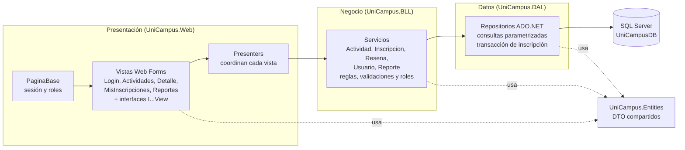
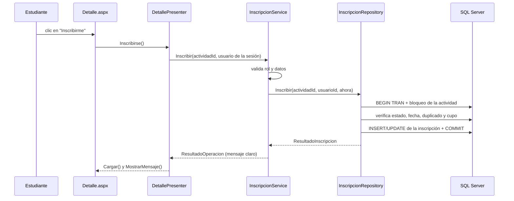

# Diagrama de arquitectura (tres capas + MVP) - entrega final

Dependencias (hacia adentro): Web -> BLL -> DAL -> SQL Server. `UniCampus.Entities` es referenciado por todas las capas.
La BLL depende de **interfaces** de repositorio (`I...Repository`), lo que permite probarla con repositorios simulados.

## Flujo de "Inscribirse"

